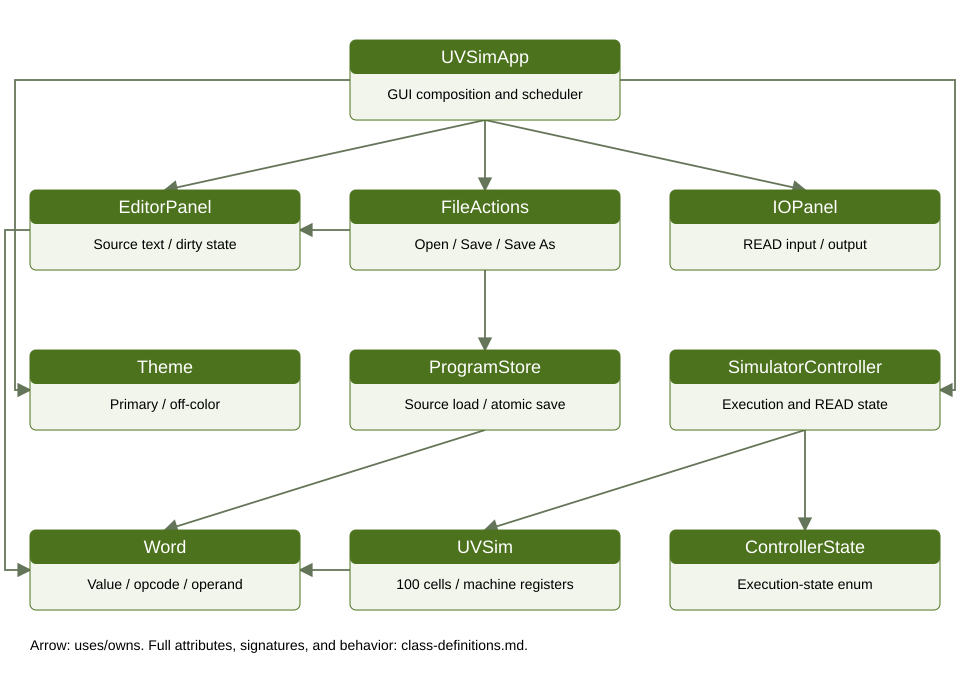
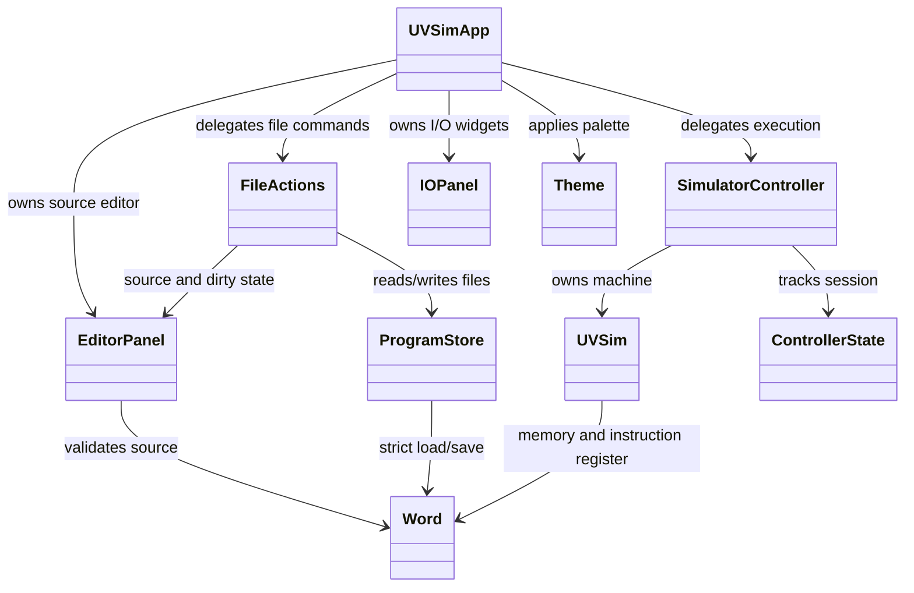

# Milestone 4 class definitions

Team A | October 23, 2026 | Current submission version

## Architecture

The ten runtime classes below use composition. ControllerState extends Enum; Theme is a frozen dataclass. No application interfaces or abstract base classes are declared. Callbacks/panel injection use structural contracts. Tkinter stays in gui/. ProgramStore and theme_config perform data access; the controller has no loader or file dependency. Legacy terminal I/O remains in UVSim default step/run and the operation handlers; the core has no Tk dependency.

Internal principle (former SRS NFR-02): preserve separation of presentation, business state, and file access. This is a team design rule rather than a customer-facing requirement. Source text, execution memory, file path/dirty state, and theme settings have distinct owners.

Method signatures below are audited against the Python AST. Properties are read accessors. Returns are None unless specified; constructor rows describe initialization rather than returning the object. Invalid-state no-ops are described explicitly.

## ControllerState

Source: `controller.py`. Session enumeration: EMPTY, READY, RUNNING, WAITING_INPUT, HALTED, STOPPED, ERROR. Extends enum.Enum; name/value are inherited. No custom methods.

## SimulatorController

Source: `controller.py`. Owns machine: UVSim, _state: ControllerState, _message: str, _outputs: list[int], and _pending_read: int or None. No file I/O or Tkinter dependency.

| Signature / property | Return; preconditions; behavior |
| --- | --- |
| `__init__(self)` | None; None; Create zeroed machine, empty outputs, no pending READ, EMPTY state. |
| `load_program(self, words: Iterable[Word])` | bool; Iterable of Word; reject active states; Validate nonempty/capacity before replacing machine. Success resets outputs/input and enters ready. ValueError becomes False/message; wrong element type raises TypeError. |
| `start(self)` | None; Initialized; Only ready becomes running; other states unchanged. |
| `tick(self, max_steps: int=100)` | None; max_steps nonnegative; acts only when running; Execute at most max_steps, returning for READ/HALT/error. WRITE appends ints; expected runtime errors enter error and preserve prior output. |
| `submit_input(self, text: str)` | bool; String; waiting_input plus pending address; Invalid values preserve state/request. Valid int becomes Word at address, advances once, clears request, resumes running. |
| `stop(self)` | None; Initialized; Active state becomes stopped, pending READ discarded, output retained; otherwise no-op. |
| `state [property]` | str; Initialized; Return lowercase enum name without mutation. |
| `message [property]` | str; Initialized; Return current explanation without mutation. |
| `outputs [property]` | list[int]; Initialized; Return copy; callers cannot mutate internal outputs. |

## UVSim

Source: `uvsim.py`. Owns memory: 100 Word references, accumulator: int, instruction_counter: int, instruction_register: Word, halted: bool. READ/STORE replace cells rather than modifying Word values. The accumulator remains an integer.

| Signature / property | Return; preconditions; behavior |
| --- | --- |
| `__init__(self)` | None; None; Allocate 100 Word(0) cells; zero registers/counter; halted false. |
| `load(self, words: list[Word])` | None; list[Word]; Validate capacity/types before reset; populate from address 00 and zero unused cells/registers. ValueError for >100; TypeError for non-Word. Empty list is allowed at this lower layer. |
| `step(self, *, defer_io: bool=False)` | tuple[str,int] or None; Valid machine state; If halted return. Fetch Word, reject negative/unsupported instruction, decode via properties. Deferred READ returns address without advancing; deferred WRITE returns int and advances. Other handlers mutate state; failing handler ValueError/EOFError restores counter. |
| `run(self)` | None; Loaded program; terminal I/O available for READ; Loop default step until HALT, propagating errors. May run indefinitely for loops; GUI uses tick instead. |

## Word

Source: `word.py`. Stores _value in -9999..9999. Public value/opcode/operand properties are read-only; internal _value is private by convention, not a frozen dataclass. Word owns sign-plus-four-digit formatting and magnitude-based decoding.

| Signature / property | Return; preconditions; behavior |
| --- | --- |
| `__init__(self, value: int)` | None; int value; Reject outside -9999..9999 with ValueError; store _value. |
| `parse(cls, text: str)` | Word; String; Strip whitespace, require sign and four digit characters, convert and range-check; ValueError explains malformed words. |
| `value [property]` | int; Initialized; Return stored signed value. |
| `opcode [property]` | int; Initialized; Return abs(value)//100. Execution separately rejects negative instructions. |
| `operand [property]` | int; Initialized; Return abs(value)%100. |
| `format(self)` | str; Initialized; Return sign and four padded digits; numeric negative zero normalizes to +0000. |
| `__eq__(self, other)` | bool; Any comparison object; True only for Word with equal value; no mutation. |

## UVSimApp

Source: `gui/app.py`. Owns root, controller, editor, file_actions, panel, Theme, toolbar widgets, filename/status variables, _timer, _closed, and _local_error (also used for file-status messages). Composes widgets and one 20 ms scheduler. No separate program-source cache remains.

| Signature / property | Return; preconditions; behavior |
| --- | --- |
| `__init__(self, root, controller, panel_factory=IOPanel, theme=None)` | None; Live Tk root/controller; panel factory supports output_parent; Build editor/file actions/shared READ/two-column output, apply Theme, bind close, refresh and schedule one timer. |
| `_resize_labels(self, event)` | None; Configure event with width; Wrap filename/status at available width. |
| `_schedule(self)` | None; Live root; Schedule one pump only if not closed and none exists. |
| `_pump(self)` | None; Live timer callback; Clear timer ID, tick when running without local error, refresh and reschedule. Closed app returns. |
| `_invoke(self, action, *args)` | Action result or False; Callable and matching args; Clear local message; convert expected OSError/ValueError/EOFError/NotImplementedError into visible failure. |
| `open_file(self)` | None; Inactive execution; Delegate FileActions.open and refresh; active calls ignored. |
| `load_file(self, path)` | bool or None; Path; inactive execution; Delegate open_path and refresh; returns accepted bool, or None when active. |
| `save_file(self)` | None; Inactive execution; Delegate save and refresh; active calls ignored. |
| `save_file_as(self)` | None; Inactive execution; Delegate save_as and refresh; active calls ignored. |
| `start(self)` | None; Inactive execution; get_words commits/validates edits, load_program resets CPU, refresh clears output, then start. Failed validation never runs previous program. |
| `_editor_changed(self)` | None; Editor callback after user edit; Clear local error and set editing status; normal periodic refresh can restore controller status. Editor retains its own validation message. |
| `_file_status_changed(self, message)` | None; Message string; Store file result/error for next refresh. |
| `confirm_discard(self)` | bool; Live app; Delegate FileActions save/discard/cancel decision. |
| `stop(self)` | None; Live app; Stop active controller and refresh. |
| `submit_input(self, text)` | bool; Text; waiting_input; Delegate validation and refresh; otherwise False. |
| `refresh(self)` | None; Live widgets; Reflect state; disable file/Run/editor mutations while active, enable Stop, update filename/status/output; Copy remains available. |
| `close(self)` | None; Live app or already closed; Ask before losing edits; cancel/failure leaves window/timer. Accepted close cancels timer and destroys root once. |

## IOPanel

Source: `gui/io_panel.py`. Owns READ widgets, output Text and scrollbar, on_submit callback, _displayed_count, and frame. The optional output_parent places output beside the editor while READ remains above both. No machine state is stored here.

| Signature / property | Return; preconditions; behavior |
| --- | --- |
| `__init__(self, parent, on_submit: Callable[[str], bool], output_parent=None)` | None; Live parent, on_submit(str)->bool, optional output_parent; Create READ/input and read-only output, disabled Submit; bind Enter. |
| `_submit(self, event=None)` | str break; Live widgets; Ignore disabled input; forward once; preserve rejected text and clear accepted input. |
| `refresh(self, state: str, outputs: Sequence[int])` | None; State string and ordered numeric outputs; Enable READ only while waiting; clear input at ready; append new output once and clear display on shorter output. Caller presents reset output before next execution. |

## EditorPanel

Source: `gui/editor_panel.py`. Owns raw _entries strings, _saved_entries baseline, _enabled, _clipboard fallback, _edit_widget/_edit_index, frame/tree/buttons/status. Raw strings permit malformed source repair. Dirty state compares source to the baseline; execution never marks it saved.

| Signature / property | Return; preconditions; behavior |
| --- | --- |
| `__init__(self, parent, on_change: Callable[[], None])` | None; Live parent and on_change callback; Create empty editor, clean baseline, buttons, tree and bindings. |
| `set_words(self, words: Sequence[Word])` | None; Sequence[Word] of at most 100; Validate types/capacity; format values and delegate set_entries. TypeError/ValueError preserve old contents. |
| `set_entries(self, entries: Sequence[str])` | None; Sequence[str] of at most 100; Validate types/capacity, cancel active edit, replace source/baseline, render invalid tags and first error. Invalid BasicML strings are allowed, not dirty. |
| `get_words(self)` | list[Word]; Live editor; Commit active edit and parse entries. Invalid row raises line/address ValueError. Empty returns []; controller rejects empty Run. |
| `is_dirty [property]` | bool; Live editor; Commit active edit then compare current strings with saved baseline. |
| `mark_saved(self)` | None; Caller has completed successful save; Commit active edit and snapshot current entries as baseline. |
| `set_enabled(self, enabled: bool)` | None; Boolean; When disabling, finish edit; set mutation controls enabled/disabled. Copy remains enabled. |
| `add_entry(self)` | None; Editor enabled; Insert +0000 before selection or append; reject at 100. Renumber, report, notify. |
| `delete_selected(self)` | None; Enabled with selected rows; Delete selection, renumber, notify. Disabled/no selection leaves contents unchanged. |
| `cut(self)` | None; Enabled and selected rows; Copy then delete selected entries. |
| `copy(self)` | None; Selected rows; Copy raw selected strings to system clipboard and local fallback; no source mutation; works read-only. |
| `paste(self)` | None; Enabled; Read clipboard/fallback, validate all lines and resulting capacity, then insert before selection or append. Invalid/oversized paste changes nothing. |
| `modify_entry(self, index: int, text: str)` | None; Enabled; valid index and string; Strip and change row, render/notify; invalid BasicML allowed. Invalid index raises IndexError. |
| `_selected_indices(self)` | list[int]; Live tree; Return sorted selected row IDs. |
| `_changed(self, selected=None)` | None; Optional selected row indices; Rebuild, report validation and invoke on_change. |
| `_refresh_tree(self, selected=None)` | None; Optional selected indices; Render addresses/values/invalid tags, preserve valid selection, refresh controls. |
| `_report_validation(self)` | None; Source entries available; Display first invalid row or entry-count/unsaved status. |
| `_update_buttons(self)` | None; Live buttons; Set mutation states from _enabled, keep Copy enabled. |
| `_on_double_click(self, event)` | None; Tk event with x/y; Enabled cell hit selects row and begins edit. |
| `_on_edit_key(self, event=None)` | str break; Optional event; Begin editing selected row only if enabled. |
| `_begin_edit(self, index: int)` | None; Existing row index; Finish previous edit, ensure visible cell, overlay Entry, bind Enter/Escape/focus-out. |
| `_finish_edit(self)` | None; Optional active Entry; Read and destroy overlay before modify_entry; disabled/no overlay is no-op. |
| `_cancel_edit(self)` | None; Optional active Entry; Destroy overlay and clear index without committing. |
| `_commit_edit_key(self, event=None)` | str break; Optional event; Finish edit and focus tree. |
| `_cancel_edit_key(self, event=None)` | str break; Optional event; Cancel edit and focus tree. |
| `_key(self, action)` | str break; Callable; Invoke action and consume key event. |
| `_select_all(self, event=None)` | str break; Optional event; Select all existing rows. |

## FileActions

Source: `gui/file_actions.py`. Owns root, store, editor, on_status callback, and _current_path. Coordinates native file dialogs and unsaved-change decisions; does not initialize the CPU.

| Signature / property | Return; preconditions; behavior |
| --- | --- |
| `__init__(self, root, store: ProgramStore, editor: EditorPanel, on_status: Callable[[str], None])` | None; Root, ProgramStore, editor and on_status callable; Store collaborators and set path None. |
| `current_path [property]` | str or None; Initialized; Return last successful Open/Save As path. |
| `open(self)` | bool; Inactive GUI caller; Native picker; cancel False, Tcl error reports False; selected path delegates open_path. |
| `open_path(self, path: str)` | bool; Path; Read source before discard decision; canceled decision False. Reread after save-aware decision, set_entries, update path/status. Read/size/encoding/Tk errors report False without partial source replacement. |
| `save(self)` | bool; Editor available; Without path delegates save_as. get_words validates; atomic save then mark_saved. OSError/ValueError reports False, preserves path/dirty state. |
| `save_as(self)` | bool; Editor available; Native destination dialog; cancel/Tcl error False. Validate/save, then update path and baseline only after success. |
| `confirm_discard(self)` | bool; Live editor; Clean returns True. Dirty prompts Yes/No/Cancel: Yes returns save result, No True, Cancel False. Failed/canceled save prevents discard. |

## ProgramStore

Source: `program_store.py`. Stateless source/validated-program reader and atomic writer. load_source serves GUI editing; load is the strict console API; save accepts validated Word objects. No Tkinter dependency.

| Signature / property | Return; preconditions; behavior |
| --- | --- |
| `load_source(self, path: str)` | list[str]; Readable UTF-8 source path; Read with utf-8-sig, strip/ignore blank lines, preserve invalid words. >100 raises ValueError; I/O/decoding errors propagate. No editor/machine mutation. |
| `load(self, path: str)` | list[Word]; Readable UTF-8 path; Strict format/range validation with original file line errors; ignore blanks; >100 ValueError. Used by console; empty list permitted. |
| `save(self, path: str, words: list[Word])` | None; Path and list[Word] up to 100; Validate before I/O, write UTF-8 lines to same-directory temporary file, os.replace destination. Clean temporary on failed replacement; errors propagate; empty file permitted. |

## Theme

Source: `theme_config.py`. Frozen dataclass with primary and off_color strings, defaulting to #4C721D and #FFFFFF. Dataclass-generated constructor/equality/repr; load_theme validates configuration before constructing the palette. Direct Theme construction assumes valid colors.

Generated API: `Theme(primary="#4C721D", off_color="#FFFFFF")` initializes both string fields; generated equality compares both fields and repr describes them. Field assignment after construction raises FrozenInstanceError. No custom methods.

## Supporting module functions

| Function | Contract |
| --- | --- |
| theme_config.load_theme(path=THEME_FILE) | Return validated Theme; use an absolute default path beside the module, independent of cwd. Missing/unreadable/malformed/incomplete config or invalid #RRGGBB colors returns both UVU defaults. Successful hex values normalize to uppercase. |
| gui.theme.apply_theme(root, theme) | Configure clam/ttk styles and existing Tk Text widgets; no return. Requires live Tk root and valid colors. Apply after composing panels; future ttk widgets inherit styles. Native dialogs retain OS styling. |
| gui.app.launch(path=None) | Build root/controller/app, optionally open source, then mainloop. Returns after close; requires Tk display. No obsolete scaffold fallback remains. |
| input_validation.parse_word(text) | Return integer -9999..9999; strip whitespace, reject blank/noninteger/out-of-range input with ValueError. READ does not require a sign or four digits. |
| loader.load_program(path) | Legacy strict parser returning list[int]; retained for compatibility/tests, not the integrated GUI file boundary. |
| main.main() | Parse optional path and GUI/console flags. GUI is default; console uses ProgramStore.load then machine.run. Return 0 normally, 1 for handled console errors; argparse may raise SystemExit. |
| operations handlers | Stateless functions mutate UVSim. LOAD copies memory.value into integer accumulator; STORE/READ replace cells with Word; WRITE formats numeric value. Arithmetic retains low four magnitude digits and sign; division truncates toward zero and rejects zero. Branch handlers update counter; HALT sets halted. |

## State and source lifecycle

Open only replaces editor source/path; it does not initialize the CPU or clear prior output. Run commits/validates current source, load_program replaces the machine and clears outputs, refresh presents the empty output, then start enters running. Tick yields at READ; valid submission resumes once. HALT/error/Stop return controls to editing. Each new Run resets memory from source. Save writes source, never the mutated machine.

## Test-only classes

TestCase fixtures and FakeController/FakePanel/FakeEditor are not runtime architecture. They assert behavior, capture callbacks, and dispose temporary files/Tk roots. The test register names every executable test method and records results separately from manual verification.