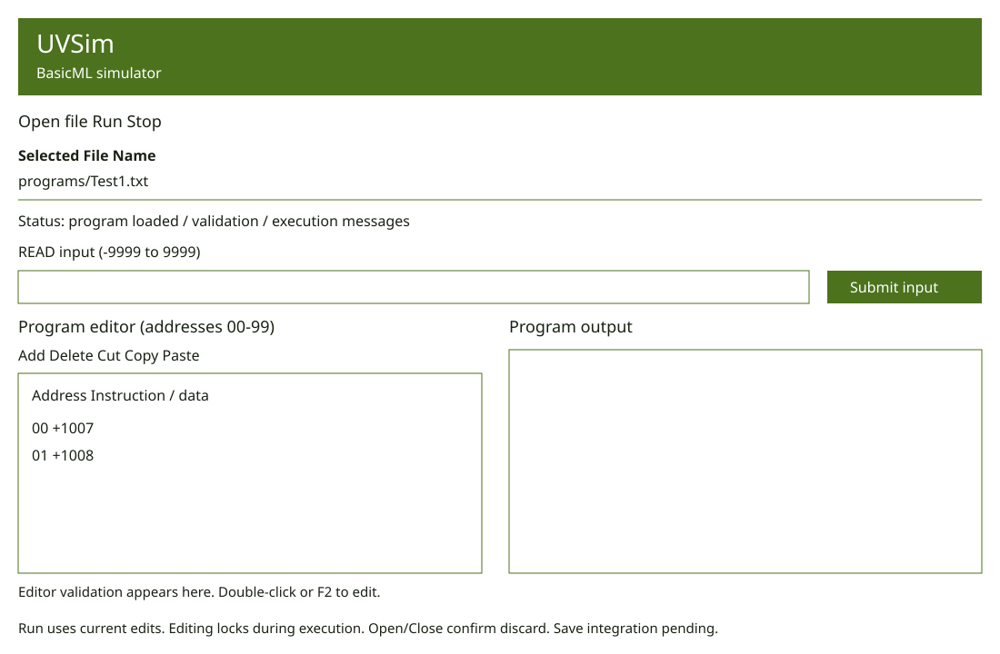

# Milestone 4 GUI — WP-1

Updated October 16, 2026. This describes the implemented branch, not the final
editor/save integration. Earlier milestone designs remain historical.

1. The header and enabled buttons use primary green; header/button text and
   content surfaces use the off-color. Dark body text is readable on default white.
2. Toolbar: Open file, Run, Stop. Open browses any accessible folder. Run starts
   a fresh execution from the loaded source, including after HALT, Stop, or error.
   Active execution disables Open/Run and enables Stop.
3. Selected File Name explicitly labels the last successfully loaded path.
4. Status/error messages precede READ input and remain visible above output.
5. READ and Submit/Enter are enabled only while waiting. Invalid input can be
   corrected; accepted input clears. Moving these controls does not change their
   controller contract.
6. Output is scrollable, read-only, and cleared before every fresh run. Closing
   cancels the one scheduled execution timer. Native file dialogs retain OS styling.

## Configuration and component handoff

`theme_config.Theme` is an immutable pair of colors. `load_theme(path)` reads
UTF-8 INI with `[theme]`, `primary`, and `off_color`. Both must be six-digit hex;
any missing/invalid setting or unreadable file returns the whole UVU palette.
The default file path is absolute and relative to the module, independent of cwd.
`gui.theme.apply_theme(root, theme)` configures ttk styles and existing Tk Text
widgets. Call it after embedding new panels; new ttk widgets inherit styles.
`UVSimApp(..., theme=None)` loads configuration unless a Theme is supplied.

Until WP-2/WP-3 are implemented, the window loads through the existing loader
and keeps original Word values separate from execution memory. On Run it calls
`controller.load_program` then `start`; output refresh occurs between reset and
execution. This temporary source cache must be replaced with `editor.get_words()`
when integrating the editor so unsaved edits become the source of each run.

Final layout will insert Save and Save As after Open, and place the editor beside
output below status and READ. Do not invoke the existing placeholder constructors
until their owners implement them. Route Open/Save and close confirmation through
FileActions, then reapply the theme to the assembled widget tree.

## Contributions for other document owners

- Use case: user edits both colors in theme.ini, saves, and restarts; the new
  scheme appears. Invalid/missing configuration results in the UVU palette.
- Functional requirement: the system shall load configurable primary/off-colors
  at startup without recompilation or reinstallation.
- Functional requirement: the system shall use #4C721D and #FFFFFF by default
  and when configuration cannot be loaded or validated.
- Nonfunctional requirement: default branding shall keep text readable.
- Test references: tests/test_theme.py and TestRealWindow in
  tests/test_gui_integration.py; supply these cases to the test spreadsheet owner.
