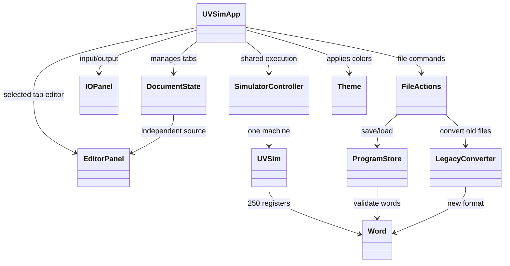

# Milestone 5 class definitions and architecture
Team A | Draft design — reconcile with integrated source before submission

## Design intent
The application retains one execution engine and separates document state from machine state. The GUI owner integrates multiple tabs and conversion controls; backend owners provide memory/word validation and conversion interfaces. This design is a proposed target, not a claim that all classes and method signatures already exist.

## Existing classes and expected changes

| Component | Source | Responsibility / Milestone 5 impact |
|---|---|---|
| UVSimApp | `gui/app.py` | Owns main window, tab selection, execution interlock, toolbar, status, shared controller and I/O panel. |
| EditorPanel | `gui/editor_panel.py` | Edits source words, displays addresses 000–249, validates six-digit words, limits entries to 250. |
| FileActions | `gui/file_actions.py` | Opens/saves selected document, coordinates conversion destination and error presentation. |
| IOPanel | `gui/io_panel.py` | Presents READ and WRITE UI using new numeric limits and formatting. |
| SimulatorController | `controller.py` | Controls shared engine states, execution, stop, READ wait, and stepping if supported. |
| UVSim | `uvsim.py` | Executes operations with 250 memory registers and six-digit machine words. |
| Word | `word.py` | Parses, formats, and validates six-digit words; instruction opcode and address are three digits each. |
| ProgramStore | `program_store.py` | Loads/saves validated program contents and tracks file errors. |
| Theme | `theme_config.py` | Stores standard RGB hexadecimal palette values. |
| LegacyConverter | proposed `converter.py` | Converts supported legacy words, rejects mixed formats, preserves source, writes converted output. |
| DocumentState | proposed conceptual model | Stores independent filename, source contents and dirty flag per tab; actual implementation may use a different name or structure. |

## State and invariants
- Exactly one SimulatorController/UVSim execution session exists per application instance.
- Each open tab retains its own program source, path and unsaved flag.
- Run loads the selected tab's current source into the shared machine.
- While running, awaiting READ, or stepping, users cannot switch active documents.
- A failed or canceled save cannot discard unsaved source.
- File conversion is one-way and never modifies the original legacy source.
- Memory addresses 000–249 are valid; address 250 is invalid.
- Signed word magnitude is limited to six decimal digits, with existing overflow semantics retained.

## Final implementation audit
After Tasks 1–3 merge, replace conceptual class names with actual class names, copy actual method signatures from source, update the diagram accordingly, and confirm ownership and dependencies. The Milestone 4 class definitions remain the historical baseline.
