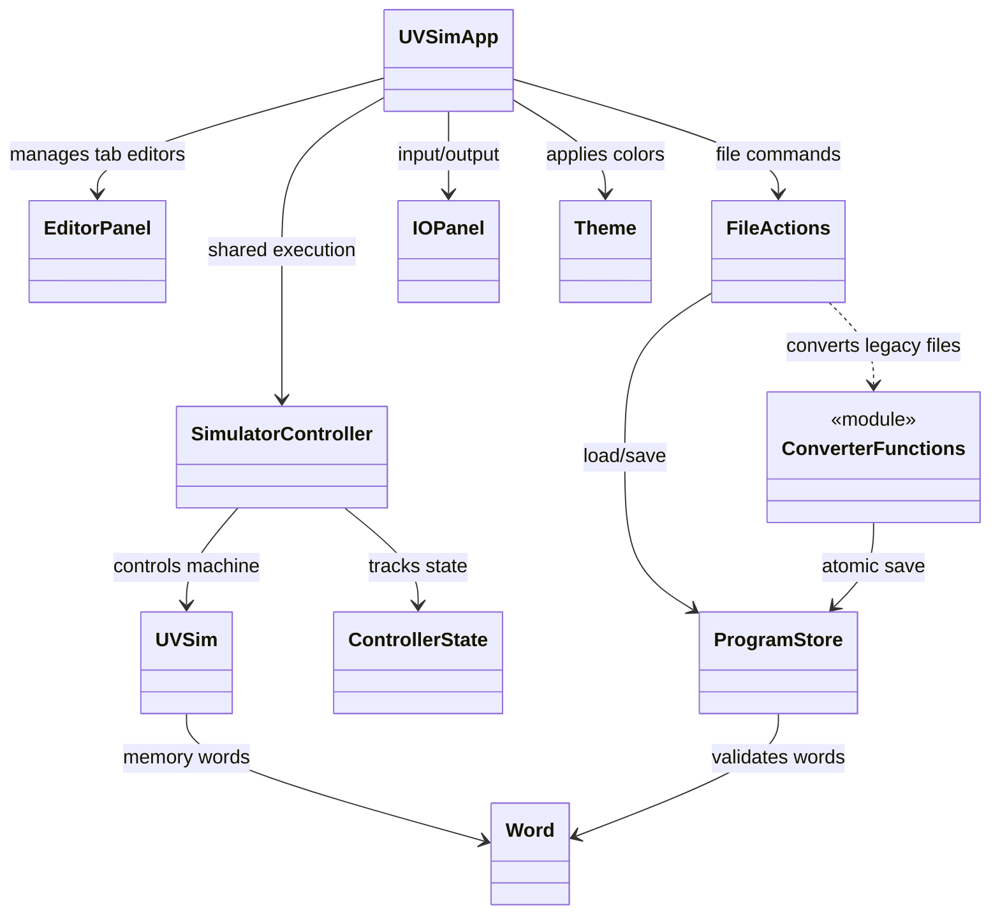

# Milestone 5 class definitions and architecture
Team A | Integrated implementation, November 13, 2026

## Design intent
The application retains one execution engine and separates document state from machine state. Multiple tabs and conversion controls use the backend memory/word validation and conversion functions.

## Classes and supporting module

| Component | Source | Responsibility / Milestone 5 impact |
|---|---|---|
| UVSimApp | `gui/app.py` | Owns the main window, multiple program tabs, per-tab document state, execution interlock, toolbar, status display, shared controller, and I/O panel. |
| EditorPanel | `gui/editor_panel.py` | Edits source words, displays addresses 000–249, validates six-digit words, limits entries to 250. |
| FileActions | `gui/file_actions.py` | Opens/saves selected document, coordinates conversion destination and error presentation. |
| IOPanel | `gui/io_panel.py` | Presents READ and WRITE UI using new numeric limits and formatting. |
| SimulatorController | `controller.py` | Controls shared engine states, execution, stop, and READ wait. |
| ControllerState | `controller.py` | Defines the execution states used by SimulatorController. |
| UVSim | `uvsim.py` | Executes operations with 250 memory registers and six-digit machine words. |
| Word | `word.py` | Parses, formats, and validates six-digit words; instruction opcode and address are three digits each. |
| ProgramStore | `program_store.py` | Loads/saves validated program contents and tracks file errors. |
| Theme | `theme_config.py` | Stores standard RGB hexadecimal palette values. |
| Converter functions (module, not a class) | `converter.py` | `detect_program_format`, `convert_program`, `write_converted_program`, and `convert_file` validate/convert legacy input and save six-digit output. |

## State and invariants
- Exactly one SimulatorController/UVSim execution session exists per application instance.
- Each open tab retains its own program source, path and unsaved flag.
- Run loads the selected tab's current source into the shared machine.
- While running or awaiting READ, users cannot switch active documents.
- A failed or canceled save cannot discard unsaved source.
- File conversion is one-way and never modifies the original legacy source.
- Memory addresses 000–249 are valid; address 250 is invalid.
- Signed word magnitude is limited to six decimal digits, with existing overflow semantics retained.

## Final implementation audit
The integrated GUI implementation has been reviewed, and the class diagram reflects the classes currently present in the source code. The diagram includes the converter module used by FileActions. The Milestone 4 class definitions remain the historical baseline.