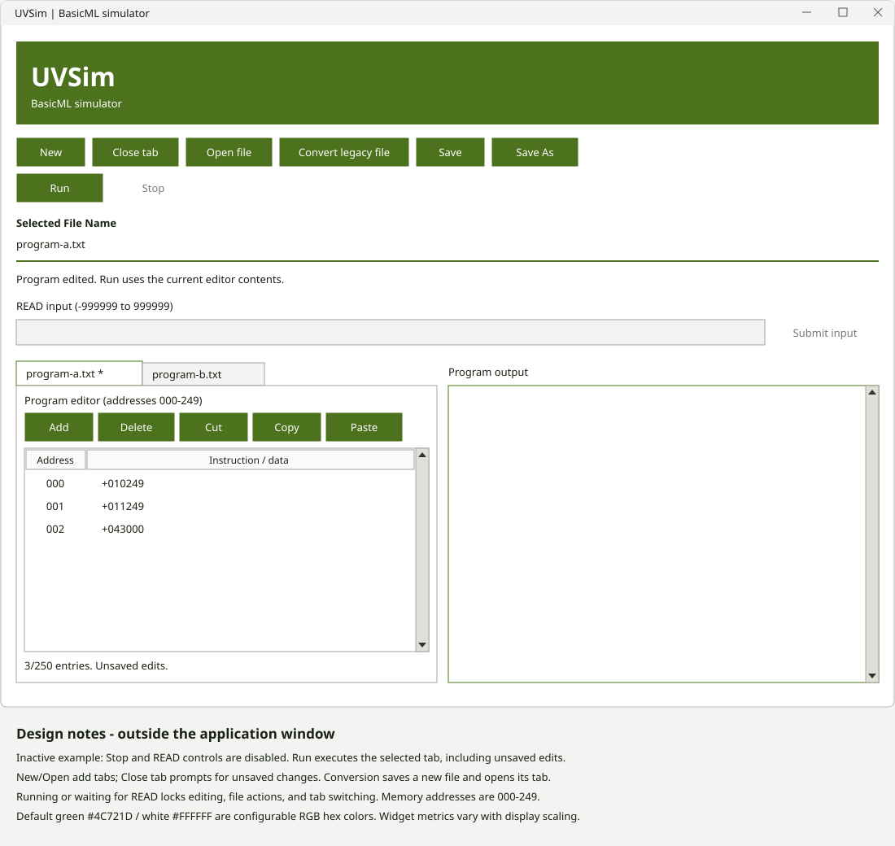

# Milestone 5 GUI wireframe and interaction notes
Team A | Integrated layout, November 13, 2026

[Open the SVG wireframe](wireframe.svg). Updated from the Milestone 4 SVG, preserving its styling and design annotations.

This schematic reflects the integrated layout; it is not a screenshot. Editor buttons share one row. Tabs represent independent open documents, with an asterisk indicating unsaved changes. Conversion selects a saved legacy file and an output destination, then opens the converted copy in a new tab. Only the active document is executed through the shared engine. Switching tabs is disabled during running or waiting for READ. The editor shows addresses 000–249 and six-digit words, and rejects capacity overflow. Status information must be visible without resizing the initial window. Register edit text must be readable while editing and after commit. Colors are standard RGB hexadecimal values (#RRGGBB), default green #4C721D and white #FFFFFF.

Remaining visual checks: confirm register-edit readability and initial status visibility on the submission machine; record results in `../verification-task4.md`.
